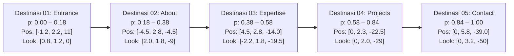

# MELLINO — THE DIGITAL ATELIER
## Master Architecture Blueprint & Technical Dossier
### Chapter 01 — Hero / Entrance: 3D Centerpiece Redesign

> **Konsep & Paradigma Arsitektur:**
> Website portofolio pribadi untuk **Mellino** (Fullstack Developer & Creative Technologist asal Malang, Jawa Timur) dirancang sebagai **The Digital Atelier**—sebuah dunia arsitektural 3D WebGL interaktif berbasis **React Three Fiber**, **Three.js**, dan **GSAP ScrollTrigger**.
> 
> Bukan website HTML vertikal biasa dengan background 3D, melainkan **perjalanan kamera interaktif di dalam ruang 3D**, di mana scrolling mengendalikan pergerakan kamera menyusuri kurva *Catmull-Rom spline*, melewati 5 destinasi spasial, sementara teks dan konten editorial hadir *in-situ* sebagai **Spatial HUD**.

---

### 1. Chapter 01 Redesign: The Sculptural Atelier Exhibition Installation

Centerpiece pada Babak 01 (Hero / Entrance) telah dirancang ulang secara eksklusif menjadi sebuah instalasi pameran arsitektur kontemporer (*Architectural Atelier Exhibition Centerpiece*) dengan materialitas premium dan siluet yang kuat, menggantikan susunan kotak primitif sebelumnya:

1. **The Gallery Plinth (Stepped Volcanic Basalt)**:
   - Podium ganda bertingkat dari batu basal vulkanik gelap (`#161513`) dengan *recessed negative shadow joint* dan *hairline brass inlay strip* (`#C58A5B`).
2. **Fluted Brutalist Monolithic Column**:
   - Tiang monolit bertekstur arang gelap dengan 8 sirip vertikal bertakik (*fluted fins*) yang menghasilkan bayangan ritmis tajam serta mahkota kapital perunggu tuang (*cast bronze*).
3. **Cantilevered Travertine Drawing Slab**:
   - Meja batu kapur/travertine krem (`#E1D8CA`) kantilever dengan chamfer miring dan *precision-cut architectural aperture* (bukaan jendela geometris).
4. **Translucent Amber Resin / Cast-Glass Prism**:
   - Blok prisma kaca terakota tembus pandang (`MeshPhysicalMaterial`, `transmission: 0.78`, `roughness: 0.22`, `ior: 1.52`, `thickness: 1.1`) yang membiaskan cahaya dan memancarkan pendaran hangat.
5. **Kinetic Architectural Armature & Gimbaled Instrument**:
   - Instrumen arsitektural kinetik berbahan kuningan sikat (*brushed brass*) dan perunggu dengan hub pivot, lengan pembagi (*calipers*), cincin langit berputar lambat, dan jarum presisi.
6. **Physical Atelier Artifacts**:
   - Gulungan kertas cetak biru arsitektur (*rolled vellum blueprint scroll*), maket miniatur paviliun berjenjang, dan pena *stylus* perunggu padat di atas meja travertine.
7. **Architectural Background Louvers**:
   - Tabir kisi-kisi kayu hitam (*louvered screen*) di latar belakang yang membingkai kedalaman spasial dan bayangan garis tipis.
8. **Cinematic Gallery Lighting**:
   - *Warm pin-spotlight* terarah (`intensity: 2.8`, `color: #FFF6E8`) dengan bayangan tajam (*castShadow*), dipadu lampu aksen *rim light* terakota (`#A65338`) dan pendaran lembut bawah plinth.

---

### 2. Lima Destinasi Spasial & Lintasan Kamera (Catmull-Rom Spline)

---

### 3. Tautan Langsung Berkas Sumber Utama

- [ZoneEntrance.tsx](file:///d:/Portofolio/portofolio-new/src/components/canvas/ZoneEntrance.tsx) — Centerpiece baru Babak 01 (Atelier Installation)
- [CameraRig.tsx](file:///d:/Portofolio/portofolio-new/src/components/canvas/CameraRig.tsx) — Spline lintasan kamera bebas tabrakan
- [DigitalAtelierScene.tsx](file:///d:/Portofolio/portofolio-new/src/components/canvas/DigitalAtelierScene.tsx) — Canvas utama dengan prop `progress` per zona
- [SpatialHUD.tsx](file:///d:/Portofolio/portofolio-new/src/components/overlay/SpatialHUD.tsx) — HUD non-overlapping dengan ruang negatif terkontrol
- [App.tsx](file:///d:/Portofolio/portofolio-new/src/App.tsx) — Pengontrol utama
